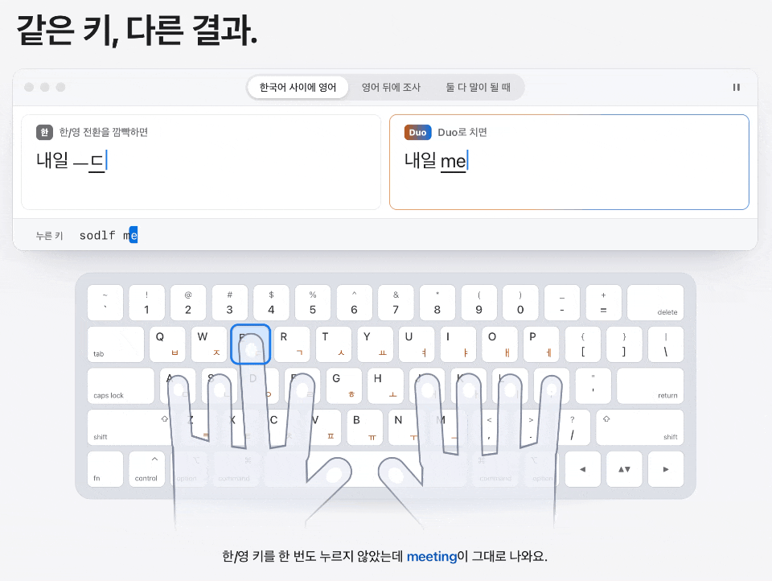

<p align="center">
  
</p>

<h1 align="center">Duo</h1>

<p align="center">한/영 전환 없이, 그냥 쓰세요.</p>

<p align="center">
  <a href="#설치">설치</a> ·
  <a href="https://gomjellie.github.io/DuoKeyboard/">안내 페이지</a> ·
  <a href="#자주-묻는-질문">자주 묻는 질문</a>
</p>

Duo는 macOS용 한국어·영어 혼합 입력기입니다.



## 설치

macOS 15 이상에서 씁니다. 터미널에 아래 명령을 붙여 넣습니다.

```sh
curl -fsSL https://gomjellie.github.io/DuoKeyboard/install.sh | zsh
```

1. 명령이 `~/Applications/Duo.app`을 설치하고 엽니다. 관리자 암호는 묻지 않습니다.
2. Duo 창에서 **Duo 켜기**를 누릅니다.
3. macOS가 Duo를 켜도 되는지 물으면 **허용**을 누릅니다.
4. 써보기 단계에서 연습장에 몇 단어 쳐 봅니다.

새 버전은 Duo가 스스로 받습니다. 설정 ▸ 일반 ▸ Duo 업데이트에서 끌 수 있습니다.

## 사용법

1. 그냥 칩니다. Space, Enter, 문장 부호를 누르면 단어가 확정됩니다.
2. 틀렸으면 <kbd>오른쪽 ⌘</kbd>를 톡 누릅니다. 치는 중이면 지금 단어가, Space를 누른 직후면 방금 쓴 단어가 바뀝니다. 한 번 더 누르면 돌아옵니다.
3. 읽기가 애매한 단어에는 캐럿 아래에 후보 막대가 뜹니다. <kbd>오른쪽 ⌘</kbd>를 누른 채 <kbd>3</kbd>을 누르면 3번 읽기를 고릅니다.
4. 이메일, 주소, 경로는 그대로 들어갑니다. `user@example.com`, `~/Library`, `github.com/foo`를 한글로 바꾸지 않습니다.
5. 고친 단어와 고른 읽기는 이 Mac 안에서 학습합니다. 같은 단어를 다시 틀리지 않습니다.
6. 앱마다 먼저 생각할 언어를 정합니다. 메뉴 막대의 입력 메뉴에서 자동, 한국어 우선, English 우선, 직접 입력 중에 고릅니다. 카카오톡은 한국어 우선, 코드 편집기는 English 우선이 기본입니다.

바꾸기 키는 설정 ▸ 일반에서 오른쪽 ⌥, ⇧ 두 번, ⇧Space, Caps Lock으로 바꿀 수 있습니다.

## 자주 묻는 질문

### 입력 메뉴에서 Duo만 흐리게 보이고 고를 수 없어요

어떤 앱이 보안 키보드 입력을 켰습니다. 암호 칸, Terminal과 iTerm2의 Secure Keyboard Entry, 일부 암호 관리자가 켭니다.
그동안에는 macOS가 Duo를 끕니다. Duo 설정 ▸ 일반 ▸ 상태에 켠 앱의 이름이 나옵니다.
그 앱에서 암호 칸을 벗어나거나 기능을 끄면 다시 고를 수 있습니다.

### VS Code나 iTerm2에서 방금 쓴 단어가 바뀌지 않아요

VS Code와 Cursor 같은 갈래, iTerm2, Hyper, JetBrains IDE, Orca는 이미 쓴 글자를 입력기가 고치지 못하게 합니다.
이런 앱에서는 "여기서는 바꿀 수 없어요"가 뜹니다. Space를 누르기 전, 단어를 치는 중에 바꾸기 키를 누르세요.

### 코딩할 때 영어가 자꾸 한글이 돼요

입력 메뉴에서 그 앱을 English 우선으로 바꿉니다.
vim이나 less처럼 키를 명령으로 쓰는 프로그램에는 직접 입력이 맞습니다. 직접 입력에서는 키가 그대로 가고, 바꾸기 키를 누르면 그 줄만 한/영을 자동으로 고릅니다.

### 텔레그램에서 Enter를 누르면 메시지가 가지 않고 줄이 바뀌어요

입력 메뉴에서 **Enter로 바로 보내기**를 켭니다. 그 앱에서는 Duo가 밑줄 없이 글자를 바로 넣습니다. 앱마다 따로 켭니다.

### 문장 처음의 so가 "내"가 돼요

한국어 글에서는 `so`를 "내"로 치는 경우가 훨씬 많아서 그렇습니다. 영어 단어 뒤에서는 so로 남습니다.
한 번 바꾸기 키로 고치면 Duo가 학습합니다. 다른 예는 [알려진 제한](docs/DEVELOPMENT.md#알려진-제한)에 있습니다.

### wq를 치면 늘 ㅈㅂ가 돼요

두 가지 방법으로 고칩니다.

- ㅈㅂ가 보이면 Space를 누르기 전에 <kbd>오른쪽 ⌘</kbd>를 톡 누릅니다.
- 이미 Space를 눌렀으면 바로 <kbd>오른쪽 ⌘</kbd>를 톡 누릅니다. 방금 쓴 ㅈㅂ가 wq로 바뀝니다.

VS Code, iTerm2처럼 이미 쓴 글자를 바꾸지 못하는 앱에서는 첫 번째 방법만 됩니다.

### 친 내용이 밖으로 나가나요?

아니요. 입력기는 인터넷에 연결하지 않습니다.
학습은 문장을 남기지 않고, 친 키와 고른 읽기만 `~/Library/Application Support/Duo/learning.json`에 남깁니다.
인터넷은 호스트 앱이 새 버전을 확인할 때만 씁니다.

## 제거

1. Duo 설정 ▸ 정보에서 **Duo 제거…**를 누릅니다. 입력 소스에서 Duo를 빼고 입력기를 지웁니다.
2. `~/Applications/Duo.app`을 휴지통에 버립니다.
3. 학습한 단어와 설정까지 지우려면 아래 명령을 실행합니다.

```sh
rm -rf ~/Library/Application\ Support/Duo
defaults delete com.inkyuoh.Duo.shared
```

## 동작 방식

Duo는 단어를 세 가지로 읽어 봅니다. 한국어, 영어, 그리고 "PR을"처럼 영어 단어 뒤에 조사가 붙은 경우입니다.
문자 언어 모델과 어휘 사전으로 읽기마다 점수를 매기고, 가장 그럴듯한 읽기를 보여 줍니다.
모델은 앱 안에 들어 있고, 모든 계산은 이 Mac에서 합니다.

학습에 쓰지 않은 글로 잰 단어 정확도는 이렇습니다.

- 한국어 뉴스와 위키백과: 99.9 %
- 영어 뉴스: 99.98 %
- 한국어와 영어가 섞인 개발자 채팅: 99.78 %
- 카카오톡 단체 대화: 99.31 %

자세한 내용은 [docs/research/detection.md](docs/research/detection.md)에 있습니다.

## 개발

Xcode와 [XcodeGen](https://github.com/yonaskolb/XcodeGen)이 필요합니다.

```sh
make project   # Duo.xcodeproj 만들기
make test      # 단위 테스트
make app       # build/Release/Duo.app 만들기
```

- 빌드, 테스트, 릴리스, 알려진 제한: [docs/DEVELOPMENT.md](docs/DEVELOPMENT.md)
- 구현 명세: [SPEC.md](SPEC.md)
- 진행 상황: [docs/STATUS.md](docs/STATUS.md)

## 감사의 말

입력기를 만들 때 [구름 입력기](https://github.com/gureum/gureum), [macSKK](https://github.com/mtgto/macSKK), [Squirrel](https://github.com/rime/squirrel), [azooKey-Desktop](https://github.com/azooKey/azooKey-Desktop), [vChewing](https://github.com/vChewing/vChewing-macOS), [Fire](https://github.com/qwertyyb/Fire)의 코드를 참고했습니다.
살펴본 제품과 가져온 아이디어는 [docs/research/](docs/research)에 있습니다.

## 라이선스

언어 모델 파일 `duo-model.bin`은 CC BY-SA 4.0 데이터로 만들었습니다. 그래서 같은 라이선스로 배포합니다.
고지문은 [DuoInputMethod/Resources/duo-model.LICENSE.txt](DuoInputMethod/Resources/duo-model.LICENSE.txt)에 있습니다.
